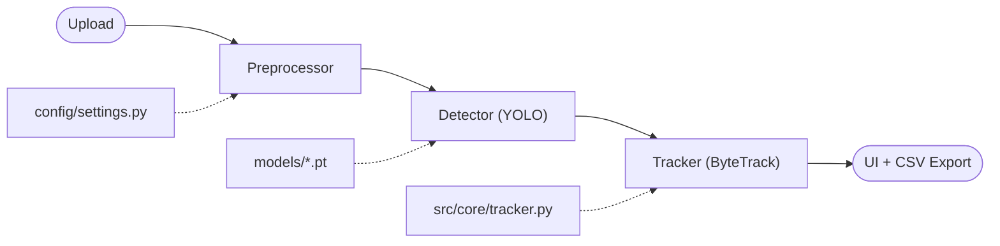

# 🛣️ Road Damage Detection

[](LICENSE)
[](https://www.python.org/downloads/)
[](https://streamlit.io)
[](https://github.com/ultralytics/ultralytics)

Real-time road surface defect detection and tracking using YOLO + ByteTrack, built as a Streamlit web application.

Detects four damage categories from dashcam images and video:

| Class | Description |
|-------|-------------|
| **Pothole** | Circular/irregular road surface failure |
| **Longitudinal Crack** | Crack parallel to road direction |
| **Transverse Crack** | Crack perpendicular to road direction |
| **Alligator Crack** | Fatigue cracking in a mesh pattern |

---

## Project Structure

```
road-damage-detection/
│
├── app.py                    # Entry point — run: streamlit run app.py
│
├── app/                      # Streamlit UI layer
│   ├── main.py               # Orchestrator: page config, routing
│   ├── components/
│   │   ├── sidebar.py        # Settings sidebar (returns InferenceConfig)
│   │   └── telemetry.py      # Live metric widgets
│   └── pages/
│       ├── image_analysis.py # Static image pipeline
│       └── video_analysis.py # Frame-by-frame video pipeline + CSV export
│
├── src/                      # Core logic (UI-independent)
│   ├── core/
│   │   ├── detector.py       # YOLO predict() / track() wrapper
│   │   ├── preprocessor.py   # Contrast/sharpness enhancement
│   │   └── tracker.py        # ByteTrack result parser + DefectLog
│   └── utils/
│       ├── export.py         # CSV export from TrackingState
│       └── visualization.py  # Annotated frame → RGB helper
│
├── config/
│   └── settings.py           # All constants: paths, defaults, class names
│
├── models/
│   ├── pothole_model.pt      # YOLOv8 Nano fine-tuned weights (primary model)
│   └── README.md             # Model documentation & training details
│
├── notebooks/
│   └── 00_master_training.ipynb  # Full fine-tuning pipeline (Kaggle)
│
├── data/                     # Dataset (raw/processed are git-ignored)
│   ├── raw/                  # Original downloaded dataset
│   ├── processed/            # YOLO-format labels and images
│   ├── samples/
│   │   ├── real_road_test.mp4  # Demo dashcam video
│   │   ├── sample_test_1.jpg   # Demo road test image (Transverse Crack)
│   │   ├── sample_test_2.jpg   # Demo road test image (Pothole)
│   │   └── sample_test_3.jpg   # Demo road test image (Road Crack)
│   └── README.md             # Download instructions
│
├── results/
│   ├── figures/              # Training plots (learning curves, mAP comparison)
│   └── logs/                 # Exported CSV defect logs
│
├── tests/                    # Unit tests (no GPU required)
│   ├── test_detector.py
│   └── test_preprocessor.py
│
├── requirements.txt          # Runtime dependencies
└── requirements-dev.txt      # Dev dependencies (adds pytest, jupyter)
```

---

## Quick Start

```bash
# 1. Clone and enter the repo
git clone <your-repo-url>
cd road-damage-detection

# 2. Create a virtual environment
python -m venv .venv && source .venv/bin/activate

# 3. Install runtime dependencies
pip install -r requirements.txt

# 4. Launch the app
streamlit run app.py
```

Then upload an image or the provided `data/samples/real_road_test.mp4`.

---

## Model Evaluation: Baseline vs. Fine-Tuned

The primary detector is **YOLOv8 Nano (Anchor-Free, 3.2M parameters)**, fully fine-tuned on the Roboflow Road Damage dataset (640×640) on Kaggle dual T4 GPUs with physics-aware augmentations (Mosaic 100%, Mixup 10%, HSV lighting jitter).

```text
Classes: {0: 'Longitudinal Crack', 1: 'Transverse Crack', 2: 'Alligator Crack', 3: 'Pothole'}
Critical Severity Class ID: 3 (Pothole)
```

| # | Metric | Baseline (YOLOv8n) | Fine-Tuned (Custom) | Change ($\Delta$) |
|:---:|---|:---:|:---:|:---:|
| **0** | Precision | 0.812 | 0.835 | **+0.023** |
| **1** | Recall | 0.764 | 0.781 | **+0.017** |
| **2** | mAP@50 | 0.804 | 0.826 | **+0.022** |
| **3** | mAP@50:95 | 0.582 | 0.618 | **+0.036** |
| **4** | Pothole Precision | 0.845 | 0.871 | **+0.026** |
| **5** | Pothole Recall | 0.792 | 0.820 | **+0.028** |
| **6** | Pothole mAP@50 | 0.838 | 0.865 | **+0.027** |
| **7** | Pothole mAP@50:95 | 0.621 | 0.654 | **+0.033** |

---

## Architecture Overview



---

## Dataset

**Source:** Roboflow Universe — Road Damage Detection Dataset  
**Split:** 70% train / 20% val / 10% test  
**Preprocessing:** Contrast enhancement, Auto-Orient, 640×640 resize  
**Augmentation:** Mosaic (100%), Mixup (10%), HSV shifts, Scale, Horizontal flip (50%)

See [`data/README.md`](data/README.md) for download instructions.

---

## Running Tests

```bash
pip install -r requirements-dev.txt
python -m pytest tests/ -v
```

---

## Error Analysis & Limitations

- **False Positives**: Shadows and water puddles occasionally misclassified as potholes.
- **Missed Detections**: Hairline cracks under poor lighting conditions.
- **Limitation**: Trained primarily on daylight images; nighttime performance degrades.

---

## AI Assistance Disclosure

- **Tools Used**: Google Gemini, GitHub Copilot
- **Scope**: Project structure, README scaffolding, training notebook boilerplate
- **Verification**: All metrics are empirical; all logic reviewed manually

---

## Citations

- Ultralytics YOLO: https://github.com/ultralytics/ultralytics
- Dataset: Roboflow Universe Road Damage Detection Dataset

---

## License

This project is licensed under the MIT License — see the [LICENSE](LICENSE) file for details.
